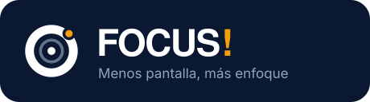

<p align="center">
  
</p>

<h3 align="center">App Android de Focus! · Kotlin + Jetpack Compose</h3>

<p align="center">
  Proyecto final de <b>Servicios Cloud</b> · Facultad de Informática, UAQ
</p>

---

Las pantallas del diseño de Figma (página *appp*) pasadas a Kotlin con Jetpack Compose.

## ☁️ Backend compartido con el portal web

La app y el portal web usan **el mismo backend**. Su código, su despliegue y su documentación están en
el repositorio [**focus_web**](https://github.com/lbarrera27-pixel/focus_web); aquí solo vive el frontend móvil.

| Parte | Dónde está | En la nube |
|---|---|---|
| 📱 **App Android** (este repo) | `app/` | Se instala en el teléfono o emulador |
| 🖥️ Portal web | [`focus_web/web/`](https://github.com/lbarrera27-pixel/focus_web/tree/main/web) | [Azure Static Web Apps](https://green-moss-07816e210.4.azurestaticapps.net) |
| ⚙️ **Backend** · API FastAPI | [`focus_web/app/`](https://github.com/lbarrera27-pixel/focus_web/tree/main/app) | [Azure App Service](https://focus-api-luisbb27.azurewebsites.net/docs) + Azure SQL + Blob Storage |
| ⚡ API serverless | [`focus_web/serverless/`](https://github.com/lbarrera27-pixel/focus_web/tree/main/serverless) | Azure Functions (`/api/ajuste-semanal`) |

Para hablar con la API, la app inicia sesión con `POST /auth/login` y manda el header
`X-Usuario-Id` en cada petición, igual que el portal web.

> [!NOTE]
> Por ahora las pantallas muestran los datos de ejemplo de Figma (`data/SampleData.kt`);
> la conexión con la API es el siguiente paso.

## Cómo abrirlo

1. Abre **Android Studio** → **File → Open** → elige la carpeta `FocusCompose`.
2. Espera a que termine el *Gradle sync* (barra de abajo).
3. Elige un emulador o tu teléfono y pulsa **▶ Run**.
4. Para ver una pantalla sin correr la app: abre su archivo (por ejemplo `HomeScreen.kt`)
   y usa la vista **Split / Design** — cada pantalla tiene su `@Preview`.

> Si Android Studio dice que no encuentra el SDK, borra `local.properties`;
> Android Studio lo vuelve a crear con la ruta correcta.

## Estructura

```
app/src/main/java/com/focus/app/
├── MainActivity.kt            ← arranca la app con FocusTheme
├── navigation/FocusNavHost.kt ← rutas y barra inferior
├── data/SampleData.kt         ← datos de ejemplo (los mismos de Figma)
└── ui/
    ├── theme/
    │   ├── Color.kt   ← variables "FOCUS / Color" (Light y Dark)
    │   ├── Type.kt    ← estilos de texto "FOCUS/…"
    │   └── Theme.kt   ← FocusTheme (claro/oscuro automático)
    ├── components/    ← componentes de la página "Componentes" de Figma
    │   ├── Buttons.kt   (Button, Botón grande, Botón atrás, Botón icono, Botón social)
    │   ├── Inputs.kt    (Campo de texto, Toggle, Chip, Segmented, Checkbox)
    │   ├── Cards.kt     (Tarjeta, tarjeta naranja, anillo, medidor de riesgo…)
    │   └── BottomNav.kt (Barra de navegación flotante)
    └── screens/
        ├── AuthScreens.kt    (17 Inicio de sesión, 23 Crear cuenta)
        ├── HomeScreen.kt     (09B Inicio)
        ├── AppsScreen.kt     (09D Mis apps)
        ├── PlanScreen.kt     (09E Tu plan)
        └── ProgressScreen.kt (22 Progreso)
```

## Cómo se pasó cada parte de Figma a código

| Figma | Kotlin |
|---|---|
| Variables de color (Light/Dark) | `FocusColors` en `Color.kt`; se usa como `FocusTheme.colors.textPrimary` |
| Estilos de texto | `FocusTypography` en `Type.kt`; se usa como `FocusTheme.type.body` |
| Componente Button (Primario/Secundario/Fantasma/Peligro) | `FocusButton(type = ButtonType.Primary)` |
| Toggle | `FocusSwitch` |
| Barra de navegación + degradado | `FloatingBottomNav` |
| Tarjeta | `FocusCard` |
| Auto layout vertical / horizontal | `Column` / `Row` con `Arrangement.spacedBy(...)` |
| Padding del marco | `Modifier.padding(...)` |
| Radio de esquina | `RoundedCornerShape(...)` |

## Paso a paso para hacer una pantalla nueva

1. **Crea el archivo** en `ui/screens/`, por ejemplo `NotificationsScreen.kt`.
2. **Escribe la función** `@Composable fun NotificationsScreen(onBack: () -> Unit)`.
3. **Elige el marco:** usa `TabScreen { … }` si la pantalla tiene barra inferior, o
   `FormScreen(onBack = onBack, rightLink = null) { … }` si tiene botón de atrás.
4. **Arma el contenido de arriba hacia abajo** como en Figma, con `Column`/`Row` y los
   componentes de `ui/components/`. Usa siempre `FocusTheme.colors` y `FocusTheme.type`
   (no escribas colores a mano), así el modo oscuro funciona solo.
5. **Agrega un `@Preview`** al final del archivo para verla en Android Studio.
6. **Conéctala en `FocusNavHost.kt`:** quita su línea del mapa `pending` y agrega un
   `composable(Routes.X) { NotificationsScreen(onBack = { navController.popBackStack() }) }`.

## Agregar la fuente Inter (opcional)

En Figma se usa Inter. Para usarla igual en la app:

1. En Android Studio: **View → Tool Windows → Resource Manager → Font → + → More fonts…**
2. Busca **Inter**, elige *Create downloadable font* y acepta.
3. En `Type.kt` cambia `val FocusFont: FontFamily = FontFamily.Default`
   por `val FocusFont = FontFamily(Font(R.font.inter))`.

## Qué falta (siguientes bloques)

Las rutas ya existen y abren una pantalla "Próximamente":
Menú (09C), Añadir app (25), Detalle de app (19), Programar Modo Foco (28),
Modo Foco (08), Ajustar meta (27), Compañero IA (11), Meta cumplida (29),
Recuperar contraseña (24). Después siguen el onboarding (01–15), notificaciones,
perfil, ayuda y los estados vacíos.
